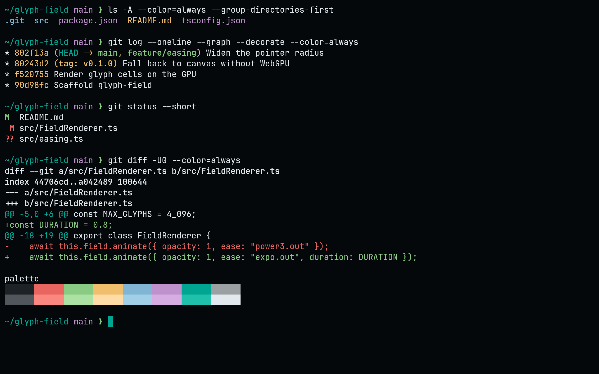
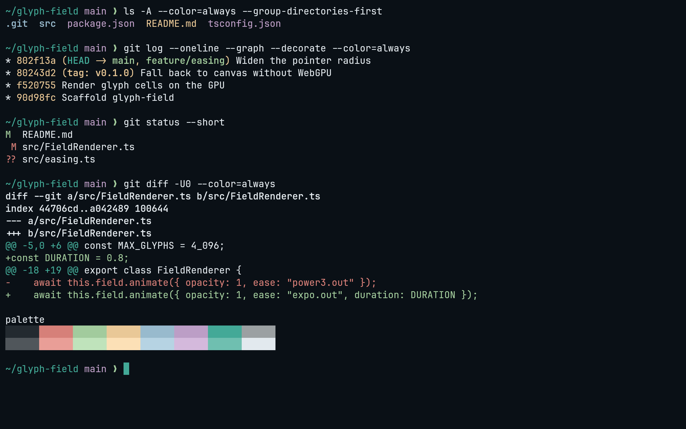
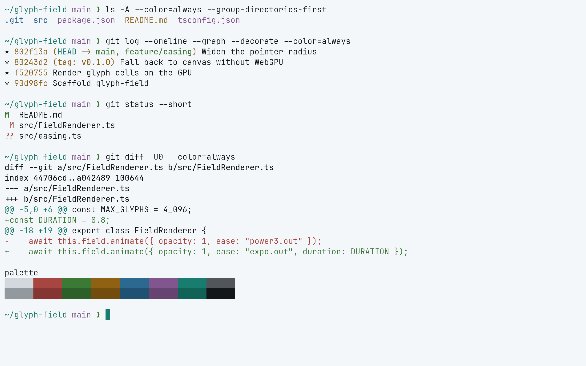
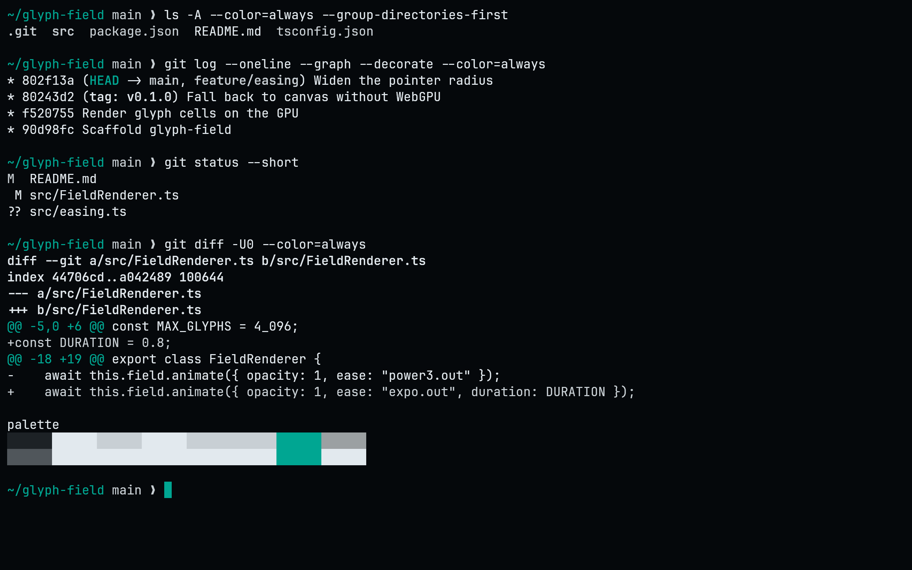

<!-- living-code-readme:1 -->
# 🐈 Living Code for Kitty

**Calm slate. Living color.** Living Code for Kitty. Four color flavors for terminal text, selections, cursors, borders, tabs and the complete ANSI palette.

[Installation](#installation) · [Flavors](#flavors) · [Configuration](#configuration) · [All ports](https://github.com/living-code-theme)

## Previews

<table data-lc-flavors>
<tr>
<td width="50%" valign="top">
<strong>Night</strong><br><sub>Dark · full palette</sub><br><br>
<a href="images/night.png"></a>
</td>
<td width="50%" valign="top">
<strong>Frost</strong><br><sub>Dark · softer chroma</sub><br><br>
<a href="images/frost.png"></a>
</td>
</tr>
<tr>
<td width="50%" valign="top">
<strong>Paper</strong><br><sub>Light · near-white slate</sub><br><br>
<a href="images/paper.png"></a>
</td>
<td width="50%" valign="top">
<strong>Signal</strong><br><sub>Dark · teal accent</sub><br><br>
<a href="images/signal.png"></a>
</td>
</tr>
</table>

Select any preview to view the image at full size.

## Installation

Download all four flavors:

```sh
curl -fsSL --create-dirs --output-dir "${XDG_CONFIG_HOME:-$HOME/.config}/kitty/themes" \
  -O "https://raw.githubusercontent.com/living-code-theme/kitty/main/living-code-{night,frost,paper,signal}.conf"
```

Add this to `kitty.conf`:

```conf
include themes/living-code-night.conf
```

Restart Kitty to apply it. Replace `night` with `frost`, `paper` or `signal` to use another flavor.

## Flavors

Expand a flavor for its full-size preview and activation instructions.

<details data-lc-flavor="night">
<summary><strong>Night</strong> · Dark · full palette</summary>

<p><a href="images/night.png"></a></p>

Set this include in `kitty.conf`:

```conf
include themes/living-code-night.conf
```

Keep only one Living Code include active, then restart Kitty.

</details>

<details data-lc-flavor="frost">
<summary><strong>Frost</strong> · Dark · softer chroma</summary>

<p><a href="images/frost.png"></a></p>

Set this include in `kitty.conf`:

```conf
include themes/living-code-frost.conf
```

Keep only one Living Code include active, then restart Kitty.

</details>

<details data-lc-flavor="paper">
<summary><strong>Paper</strong> · Light · near-white slate</summary>

<p><a href="images/paper.png"></a></p>

Set this include in `kitty.conf`:

```conf
include themes/living-code-paper.conf
```

Keep only one Living Code include active, then restart Kitty.

</details>

<details data-lc-flavor="signal">
<summary><strong>Signal</strong> · Dark · teal accent</summary>

<p><a href="images/signal.png"></a></p>

Set this include in `kitty.conf`:

```conf
include themes/living-code-signal.conf
```

Keep only one Living Code include active, then restart Kitty.

</details>

## Configuration

Theme files only set colors; your fonts, padding, opacity, shell and keybindings stay unchanged. Put any personal color overrides after the theme include.

All four installed flavors are also available in `kitten themes`. See [Kitty’s configuration reference](https://sw.kovidgoyal.net/kitty/conf/) for application settings.

## Compatibility

For the Kitty terminal on Linux and macOS. Includes all 16 ANSI colors, foreground and background, selection, cursor, URL, border, tab and mark colors. No plugin or build step is required. Applications with their own syntax themes, such as Neovim, need their matching Living Code port.

## Contributing

Found a problem? [Open an issue](https://github.com/living-code-theme/kitty/issues/new/choose) with the app version, the flavor and a screenshot. Want Living Code somewhere else? [Request a port](https://github.com/living-code-theme/core/issues/new?template=port-request.yml).

Pull requests are welcome. Keep this README, `port.json` and `images/` in sync, and use real screenshots of the app, never mockups.

🦎 **One chameleon, many habitats.** Part of [Living Code](https://github.com/living-code-theme).

## License

[MIT](LICENSE) © Elliot Luque
